<div align="center">

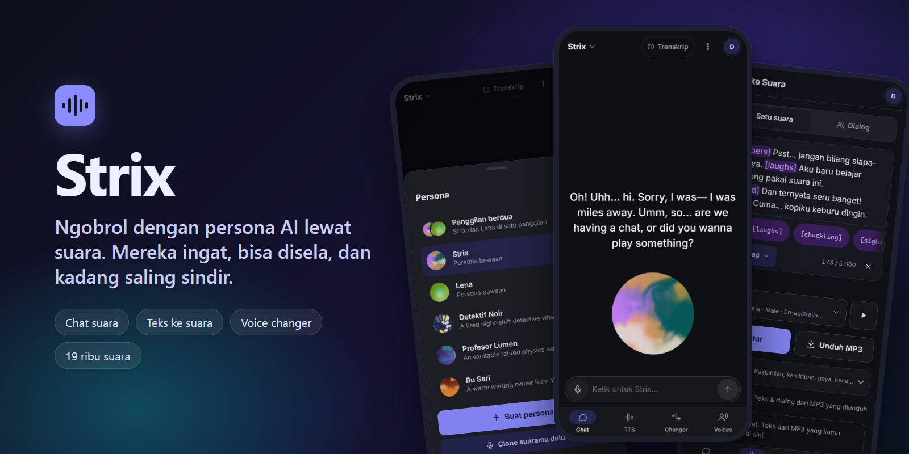

# Strix

**Ngobrol dengan persona AI pakai suara. Mereka mendengar, menjawab dengan suaranya sendiri, ingat obrolan kemarin, dan boleh kamu sela kapan saja.**

[](LICENSE)
[](https://nodejs.org/)
[](https://www.typescriptlang.org/)
[](#-uji-coba-tertutup-sampai-20-oktober-2026)

[Fitur](#-yang-bisa-dilakukan) · [Screenshot](#-screenshot) · [Cara kerja](#-cara-kerja) · [Jalankan sendiri](#-menjalankan-di-komputer-sendiri) · [Deploy](#-deploy-ke-vps) · [In English](#-in-english)

</div>

## ⏳ Uji coba tertutup sampai 20 Oktober 2026

> [!IMPORTANT]
> Versi yang sedang berjalan adalah **uji coba sementara, khusus untuk orang yang diundang**. Masuknya pakai akun Google, lalu kode undangan dari admin. Layanan ini **ditutup pada 20 Oktober 2026** (tanggalnya diambil dari `TEST_END_DATE` di server). Setelah tanggal itu layanannya tidak bisa dipakai lagi.
>
> Selama uji coba, apa saja bisa berubah atau rusak tanpa pemberitahuan. Kodenya tetap terbuka di sini dengan lisensi MIT, jadi kamu bisa menjalankan versimu sendiri.

## 👋 Apa ini?

Strix adalah aplikasi web kecil untuk bicara dengan persona AI. Tidak ada gelembung chat. Yang ada cuma sebuah bola di bawah layar yang bergerak waktu persona bicara, dan teks yang muncul kata demi kata, pas dengan suaranya.

Selain chat, ada tiga alat suara lain: teks ke suara, pengubah suara (voice changer), dan koleksi suara dari library ElevenLabs. Semuanya berjalan di satu server Node kecil. Kunci API tidak pernah dikirim ke browser.

Proyek ini dibuat sebagai eksperimen pribadi. Bagian yang sudah teruji dan yang belum ditulis apa adanya di [Batasan yang diketahui](#-batasan-yang-diketahui).

## ✨ Yang bisa dilakukan

### 🎙️ Chat suara dengan persona
- **Bola di tengah bawah, caption di atasnya.** Kata-kata muncul mengikuti jam audio yang sebenarnya, jadi teks tidak berlari mendahului suara.
- **Boleh disela.** Tekan mik saat persona bicara, atau nyalakan **Mode Percakapan**: mik tetap terbuka, kamu bisa memotong, bilang "mm-hm" tanpa menghentikannya, atau bilang "lanjut". Persona tahu persis di kata mana ia terpotong.
- **Cari di web, tapi bilang dulu.** Kalau kamu menanyakan sesuatu yang baru (cuaca, berita, skor), persona mengucapkan dulu "sebentar, aku cek dulu", baru mencari. Sumbernya muncul sebagai chip yang bisa diketuk. Bisa dimatikan dengan sakelar "Cari di web".
- **Ingatan lintas percakapan.** Setelah obrolan, ringkasan singkat, beberapa fakta, dan suasana hati persona disimpan di server. Persona yang tadi menutup telepon karena kesal masih agak dingin waktu kamu telepon lagi, lalu pelan-pelan reda. Semuanya bisa dilihat dan dihapus di lembar **Ingatan**.
- Bisa diketik, ditekan-tahan untuk bicara, atau mode bebas tangan.

### 📞 Panggilan berdua (dan bertiga)
- Masukkan sampai tiga persona (bawaan atau buatanmu) ke satu panggilan. Mereka bicara denganmu **dan satu sama lain**. Yang sedang bicara membesar, caption berwarna sesuai pembicara.
- Waktu kamu menelepon seseorang, yang sudah ada di panggilan bereaksi keras ("tunggu, kamu nelepon DIA?"). Yang ditelepon bisa mengangkat, menolak, atau membiarkannya berdering.
- Persona juga bisa menelepon persona lain sendiri, dan bisa pamit atau keluar sambil marah kalau sudah tidak tahan.

### 🔮 Persona buatan sendiri
- Isi nama, sifat, aksen, bahasa, suara, dan sapaan. Atau ketik idenya lalu tekan **Bantu AI**: server mencari tokohnya di web, lalu mengusulkan deskripsi, aksen, sapaan, dan warna bola.
- Editornya berupa **bola kaca** yang terisi tinta warna saat kamu memasukkan bahan. Kamera bisa menyelam ke dalam bola, tempat formulirnya melingkar di dinding.
- Untuk tokoh publik nyata, server menambahkan aturan roleplay yang tetap. Permintaan tentang orang biasa (tetangga, teman) diarahkan ke persona orisinal tanpa data orang itu.
- Setiap suara dan persona punya **bola unik**, dan bisa diatur sendiri di **Studio Bola**.

### 🗣️ Teks ke suara
- Model `eleven_v4_turbo`. **Audio tag** seperti `[whispers]`, `[laughs]`, `[sighs]` diwarnai ungu langsung di kotak teks.
- **Auto tag** hanya menyisipkan tag dan tidak mengubah satu kata pun. Server memeriksanya: kalau ada kata yang berubah, hasilnya dibuang.
- **Mode Dialog**: tulis `Nama: kalimat` per baris, beri tiap pembicara suaranya sendiri (maksimal 6), dengar per baris, lalu unduh sebagai satu MP3.

### 🔁 Voice changer
- Unggah atau rekam audio, pilih suara tujuan, bandingkan versi asli dan hasilnya, lalu unduh MP3. Ada opsi "Hapus noise latar" untuk rekaman di tempat ramai.

### 📚 Library suara dan clone suara
- Jelajahi seluruh **Voice Library publik ElevenLabs** (sekitar 19 ribu suara) dengan pencarian, filter, dan pratinjau. Tambahkan yang kamu suka ke koleksimu.
- **Clone suaramu sendiri** dari 1 sampai 3 sampel. Wajib mencentang persetujuan, dan hanya untuk suaramu sendiri atau suara yang kamu punya izinnya.

### 🌌 Tur 3D untuk pengguna baru
- Pertama kali masuk, kamu melihat catatan "Tentang uji coba", lalu tur singkat yang dinarasikan Strix: empat panel aplikasi yang dilalui kamera 3D, dengan satu aksi kecil di tiap langkah dan peta suara yang bisa digeser dan di-zoom. Tidak ada timer. Kamu yang menentukan kapan lanjut.

## 📸 Screenshot

Diambil dari aplikasi yang berjalan di komputer lokal dengan akun uji `demo@example.com`. Tiga persona buatan di daftar adalah contoh.

<table>
  <tr>
    <td align="center" width="33%">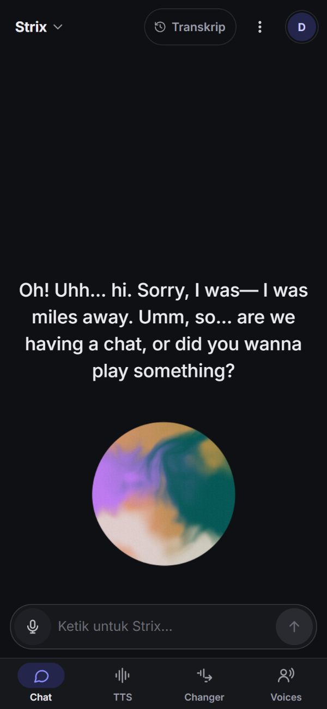<br><sub><b>Chat suara.</b> Bola di bawah, caption ikut suara.</sub></td>
    <td align="center" width="33%">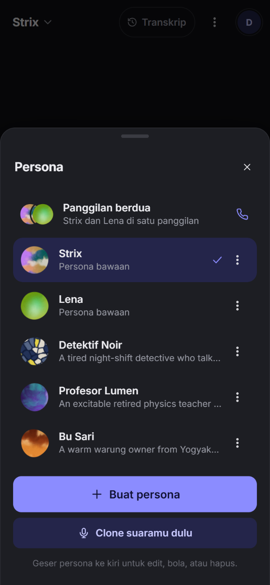<br><sub><b>Persona.</b> Tiap persona punya bolanya sendiri.</sub></td>
    <td align="center" width="33%">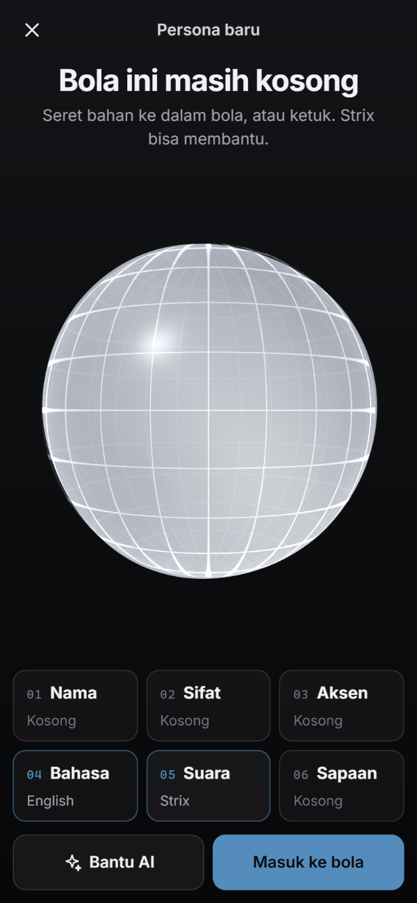<br><sub><b>Pembuat persona.</b> Bola kaca yang diisi bahan.</sub></td>
  </tr>
  <tr>
    <td align="center">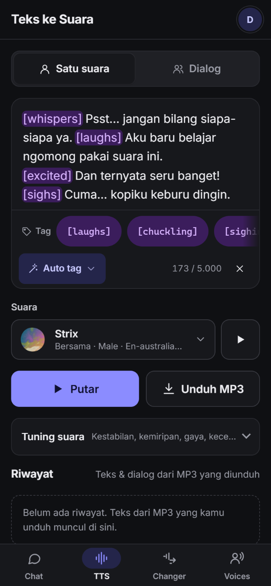<br><sub><b>Teks ke suara.</b> Audio tag berwarna ungu.</sub></td>
    <td align="center">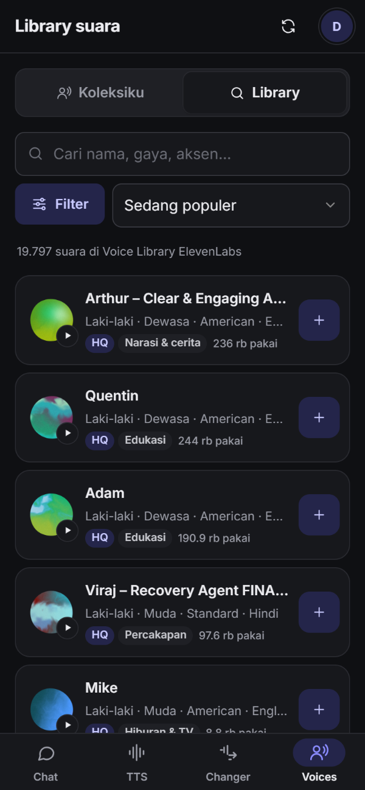<br><sub><b>Library suara.</b> Sekitar 19 ribu suara publik.</sub></td>
    <td align="center">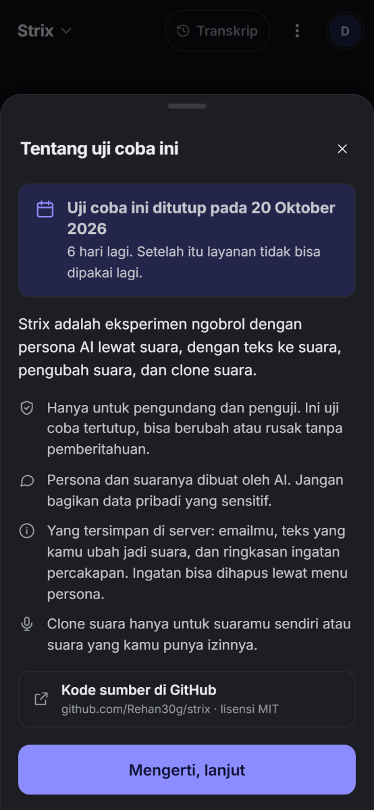<br><sub><b>Tentang uji coba.</b> Muncul sekali saat pertama masuk.</sub></td>
  </tr>
  <tr>
    <td align="center">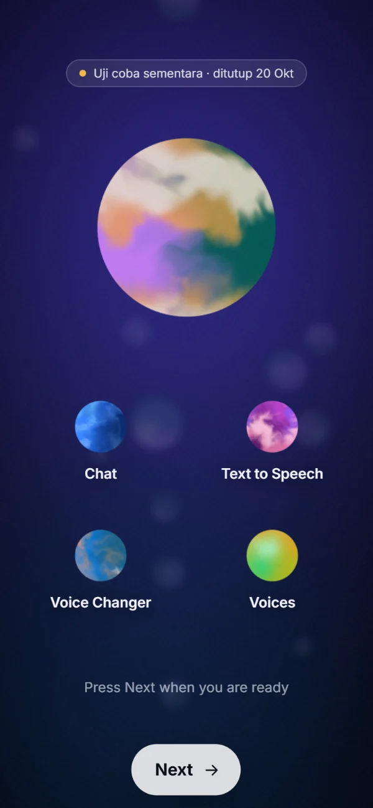<br><sub><b>Tur 3D, pembuka.</b> Empat fitur, empat bola.</sub></td>
    <td align="center">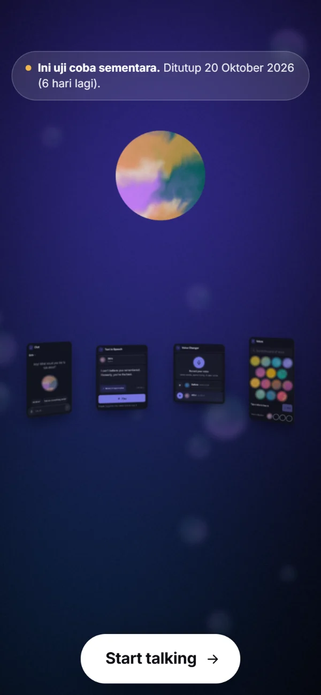<br><sub><b>Tur 3D, penutup.</b> Dengan pengingat uji coba.</sub></td>
    <td align="center">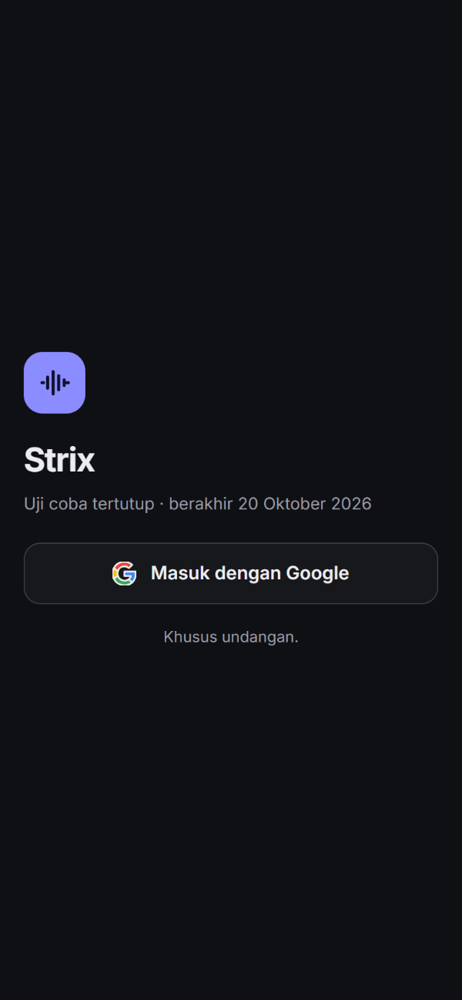<br><sub><b>Masuk.</b> Google, lalu kode undangan.</sub></td>
  </tr>
</table>

<sub>Panggilan berdua belum ada screenshotnya: layar itu baru hidup kalau persona benar-benar bicara, dan itu butuh panggilan model berbayar.</sub>

## 🧭 Cara kerja

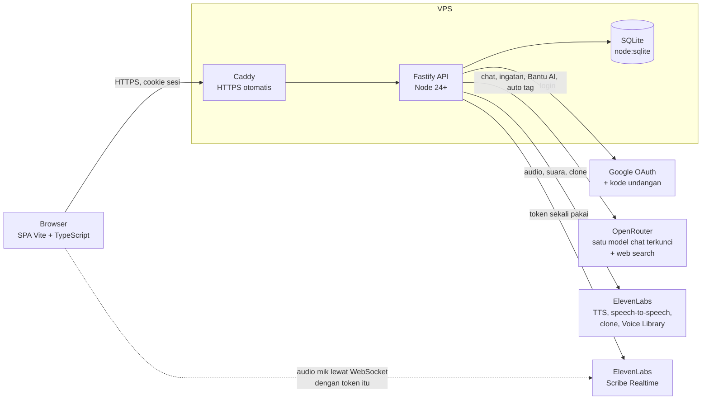

Satu proses Node melayani API dan aplikasi web sekaligus. Data tersimpan di satu file SQLite. Jawaban chat dikirim lewat SSE, lalu dipotong per kalimat dan langsung dibacakan, supaya suara pertama keluar secepat mungkin.

### Keputusan desain yang menarik

- **Satu model, dikunci di server.** Tidak ada pilihan model di aplikasi. Chat selalu memakai `OPENROUTER_MODEL`. Keputusan cepat seperti "ini interupsi atau cuma 'mm-hm'?" dan ringkasan ingatan memakai `OPENROUTER_DECISION_MODEL`. TTS selalu `eleven_v4_turbo`. Kalau klien mengirim field `model`, field itu dibuang diam-diam.
- **Kunci tidak pernah ke browser.** Semua panggilan ke OpenRouter dan ElevenLabs lewat server. Untuk mik, server membuat token Scribe sekali pakai, lalu browser mengirim audionya langsung dengan token itu.
- **Kuota per akun, direset tiap hari (UTC).** Permintaan LLM, karakter TTS, detik voice changer, detik mik, pencarian web, ringkasan ingatan, dan panggilan grup dihitung terpisah. Admin bisa mengubahnya per orang. Kalau ElevenLabs gagal atau kamu membatalkan sebelum audio mulai, karakternya dikembalikan.
- **Kode undangan 1 sampai 4 pemakaian**, dengan masa berlaku. Akun yang belum menukarkan kode hanya bisa membuka `/api/me`, halaman tukar kode, dan logout.
- **Leveler volume.** Tiap suara dan tiap audio tag keluar dari TTS dengan kerasnya masing-masing (`[whispers]` jelas lebih pelan). Browser mengukur loudness tiap klip saat diputar, mengingat tingkat biasa per suara, lalu menyamakannya, dengan limiter di ujung. Bisa dimatikan lewat "Samakan volume suara".
- **Caption sinkron per kata.** Waktu tiap kata diperkirakan dari panjang huruf, tanda baca, jeda, dan audio tag, lalu dicocokkan dengan jam audio yang sebenarnya. Hasilnya sekaligus menjadi titik potong saat kamu menyela, jadi persona tahu kalimat mana yang belum sempat kamu dengar.
- **Auto tag tidak boleh mengubah kata.** Model hanya memilih tag per kalimat. Server menyusun ulang teksnya, lalu memeriksa bahwa teks tanpa tag sama persis dengan teks aslimu.

<details>
<summary><b>Detail teknis lain</b></summary>

- **Stack:** TypeScript di mana-mana. Fastify 5, Zod 4, dan `node:sqlite` bawaan Node di server. Vite tanpa framework UI di web. Bola digambar dengan satu kanvas WebGL bersama (ada cadangan Canvas 2D), dan semua animasi menghormati `prefers-reduced-motion`.
- **Interupsi:** satu state machine giliran bicara (`web/src/lib/duplex.ts`). Aturan cepat dicek dulu (kata seperti "stop", "tunggu", "lanjut", deteksi gema suara persona sendiri), dan baru kalau ragu ditanyakan ke model keputusan dengan batas waktu 1,5 detik.
- **Panggilan grup:** sebuah "sutradara" kecil di server memilih siapa bicara berikutnya, kebanyakan dengan aturan dan sisanya dengan model keputusan. Tiap giliran bicara persona dihitung sebagai satu permintaan LLM, dengan batas per panggilan supaya tidak ada percakapan tanpa ujung.
- **Ingatan:** suasana hati memudar di server dengan waktu paruh per jenis (kesal sekitar 1,5 jam, marah 3 jam, hangat 72 jam). Kalimat ringkasan yang terdengar seperti instruksi dibuang, dan email, nomor telepon, serta alamat disamarkan.
- **Keamanan HTTP:** CSP ketat (tanpa script inline maupun CDN), pemeriksaan `Origin` untuk semua request yang mengubah data, rate limit per IP, dan cookie sesi httpOnly.
- Kontrak API lengkap ada di [`server/CONTRACT-NOTES.md`](server/CONTRACT-NOTES.md), catatan frontend di [`web/CONTEXT-NOTES.md`](web/CONTEXT-NOTES.md).

</details>

## 💻 Menjalankan di komputer sendiri

Butuh **Node.js 24 atau lebih baru** (memakai `node:sqlite` bawaan), plus kunci API OpenRouter dan ElevenLabs.

```bash
npm install
npm --prefix web install          # atau sekaligus: npm run install:all
cp .env.example .env              # isi OPENROUTER_API_KEY dan ELEVENLABS_API_KEY,
                                  # set DEV_FAKE_LOGIN=1 dan ADMIN_EMAILS=admin@example.com

npm run dev:server                # API di http://localhost:3000
npm run dev:web                   # aplikasi di http://localhost:5173 (meneruskan /api ke :3000)
```

Masuk tanpa Google (hanya mode pengembangan; server menolak menyala kalau flag ini aktif bersama `NODE_ENV=production`):

```text
http://localhost:5173/api/auth/dev-login?email=admin@example.com&redirect=/
```

Email di `ADMIN_EMAILS` langsung aktif sebagai admin. Email lain masuk sebagai akun tertunda dan perlu kode undangan, yang bisa kamu buat di halaman Admin.

Build produksi: `npm run build && npm start` (satu port untuk API dan aplikasi). Catatan pengembangan lengkap ada di [`DEVELOPMENT.md`](DEVELOPMENT.md).

> [!NOTE]
> Klip narasi tur dibuat dengan clone suara pribadi, jadi **tidak ikut di repo ini**. Tanpa klip itu tur berjalan tanpa narasi. Lihat [Keamanan dan privasi](#-keamanan-dan-privasi).

## 🚀 Deploy ke VPS

Panduan lengkapnya ada di [`deploy/deploy.md`](deploy/deploy.md): klien OAuth Google, file env, systemd, Caddy, admin pertama, backup, dan cara menurunkan layanan setelah uji coba selesai. Versi singkatnya untuk Ubuntu 22.04 atau 24.04:

1. Arahkan domain ke VPS, lalu jalankan sekali [`deploy/bootstrap.sh`](deploy/bootstrap.sh) (baca dulu isinya):
   ```bash
   sudo bash bootstrap.sh <domain> <user-deploy>
   ```
   Skrip ini memasang Node, Caddy, ufw, dan fail2ban, membuat user `strix`, menulis `/etc/strix/strix.env` dengan `SESSION_SECRET` baru dan kolom kunci yang masih kosong, lalu memasang unit systemd dan situs Caddy.
2. Isi kunci di `/etc/strix/strix.env` (Google, OpenRouter, ElevenLabs, `ADMIN_EMAILS`).
3. Jalankan [`deploy/deploy.sh`](deploy/deploy.sh) sebagai user deploy. Skrip ini menarik kode terbaru, menjalankan `npm ci`, build, restart layanan, lalu mengecek `/api/healthz`. Jalankan lagi tiap kali ada pembaruan.
4. [Caddy](deploy/Caddyfile) mengurus sertifikat HTTPS sendiri dan tidak menahan stream SSE maupun audio. Port 3000 hanya mendengarkan di `127.0.0.1`.

## ⚙️ Konfigurasi

Semua lewat variabel lingkungan. Daftar lengkap dan nilai bawaannya ada di [`.env.example`](.env.example). Yang paling penting:

| Variabel | Untuk apa |
|---|---|
| `NODE_ENV`, `PORT`, `HOST` | Mode dan alamat server. Di produksi bawaannya `127.0.0.1`, di belakang Caddy. |
| `PUBLIC_URL` | Alamat publik. Redirect Google = `PUBLIC_URL` + `/api/auth/google/callback`. |
| `TRUST_PROXY` | `1` di belakang Caddy, supaya rate limit melihat IP asli. |
| `SESSION_SECRET` | Minimal 32 karakter acak. Wajib di produksi. |
| `GOOGLE_CLIENT_ID`, `GOOGLE_CLIENT_SECRET` | Login Google (scope `openid email profile`). |
| `ADMIN_EMAILS` | Daftar email admin, dipisah koma. Admin tidak perlu kode undangan. |
| `DEV_FAKE_LOGIN` | `1` untuk login palsu saat pengembangan. Ditolak di produksi. |
| `OPENROUTER_API_KEY` | Kunci OpenRouter. Hanya di server. |
| `OPENROUTER_MODEL` | Satu-satunya model chat. |
| `OPENROUTER_DECISION_MODEL` | Model kecil dan cepat untuk keputusan interupsi, sutradara panggilan grup, dan ringkasan ingatan. |
| `ELEVENLABS_API_KEY` | Butuh izin `voices_read`, `text_to_speech`, `speech_to_text`, `speech_to_speech`, dan `voices_write` (untuk clone dan menambah suara library). |
| `ELEVENLABS_STS_MODEL` | Model voice changer (bawaan `eleven_multilingual_sts_v2`, karena v4 turbo tidak bisa speech-to-speech). |
| `SHARED_VOICE_IDS`, `SHARED_VOICE_NAMES` | Suara yang boleh dipakai semua pengguna aktif, beserta nama tampilannya. |
| `MAX_ACCOUNT_VOICE_SLOTS_USED` | Batas slot suara akun ElevenLabs yang boleh dipakai aplikasi. |
| `QUOTA_*`, `MAX_*` | Kuota harian per akun (LLM, TTS, voice changer, mik, pencarian, ingatan) dan batas clone, koleksi, serta ukuran unggahan. |
| `DUO_*` | Batas panggilan grup: jumlah persona, kalimat per panggilan, panggilan per hari. |
| `RATE_*` | Rate limit per menit. |
| `TEST_END_DATE` | Tanggal uji coba ditutup (`YYYY-MM-DD`, bawaan `2026-10-20`). Tampil di halaman masuk, catatan pertama, dan lembar akun. |

## 🔒 Keamanan dan privasi

**Yang disimpan di server:**
- Email, nama, dan URL foto dari akun Google, plus status akun dan kode undangan yang dipakai.
- Teks yang kamu ubah jadi suara (riwayat TTS).
- Ringkasan ingatan persona: ringkasan singkat, fakta, suasana hati, dan kabar antarpersona.
- Pengaturanmu, termasuk persona buatanmu.
- Angka pemakaian harian untuk kuota.

**Yang tidak disimpan di server:** audio apa pun, dan log percakapan lengkap. Hasil suara langsung dikirim ke browser, dan log chat hanya ada di perangkatmu sendiri. Perlu diingat, teks, audio voice changer, sampel clone, dan audio mik tetap diproses oleh OpenRouter atau ElevenLabs sesuai fungsinya.

**Menghapus ingatan:** buka menu persona, pilih **Ingatan**, lalu **Lupakan semuanya**. Kabar yang beredar antarpersona bisa dihapus terpisah. Menghapus persona buatan ikut menghapus ingatannya.

**Clone suara** hanya untuk suaramu sendiri atau suara yang kamu punya izinnya. Tanpa centang persetujuan, server menolak. Setelah uji coba, admin menghapus clone para penguji dari akun ElevenLabs ([langkahnya](deploy/deploy.md#8-taking-the-preview-down)).

**Klip narasi tur** (`web/public/intro/t_*.mp3`, `r_*.mp3`, `tts_*.mp3`, `vc_out.mp3`) dibuat dengan clone suara pribadi, jadi sengaja tidak disertakan. Kalau mau, buat sendiri dengan suara yang boleh kamu pakai, lalu taruh di jalur yang sama. Nama, durasi, dan waktu tiap kata ada di `tour.json`.

Jangan bagikan data pribadi yang sensitif ke persona. Semua jawaban dan suaranya dibuat oleh AI.

## 🚧 Batasan yang diketahui

- **Login Google asli belum diuji menyeluruh.** Pengujian lokal memakai login dev.
- **Belum diuji di HP sungguhan.** Tata letak sudah dicek di Edge headless dengan ukuran layar ponsel dan sentuhan yang diemulasikan, tetapi belum di iOS atau Android asli, dengan keyboard layar dan mikrofon sungguhan.
- **Mode percakapan penuh adalah simulasi.** Isinya Scribe Realtime, model keputusan, dan TTS, bukan model speech-to-speech asli. Ada jeda sekitar satu detik sebelum persona berhenti, dan tanpa headphone suaranya sendiri bisa bocor kembali ke mik.
- **Slot suara library.** ElevenLabs tidak memberi angka batas slot yang pasti untuk suara library, jadi aplikasi menghitung sendiri secara hati-hati dan menjawab "slot penuh" kalau menurutnya batas sudah tercapai.
- Tur tanpa klip narasi pribadi belum dicoba sampai tuntas.

## 🗂️ Struktur repo

```text
server/            API Fastify + TypeScript (auth, kuota, chat, ingatan, panggilan grup, TTS, suara, voice changer, STT)
web/               aplikasi web Vite + TypeScript tanpa framework UI
  src/screens/     layar: chat, duo (panggilan grup), tts, vc, voices, admin
  src/ui/intro/    tur 3D
  public/intro/    tour.json dan klip pratinjau suara untuk tur
deploy/            bootstrap.sh, deploy.sh, Caddyfile, strix.service, deploy.md
docs/screenshots/  gambar untuk README ini
_archive/          kode lama yang dikeluarkan dari build (tidak dipakai)
SPEC*.md           spesifikasi desain: SPEC.md (awal), SPEC-LITE.md (cakupan yang dibangun), SPEC-DUO.md (panggilan grup)
```

## 📄 Lisensi dan hak cipta

Kode di repo ini memakai [lisensi MIT](LICENSE).

Lisensi itu hanya berlaku untuk kode. Pemakaian OpenRouter dan ElevenLabs tunduk pada ketentuan mereka masing-masing, termasuk masa pemberitahuan dan moderasi untuk suara di Voice Library. Hak atas suara yang kamu clone atau pakai adalah tanggung jawabmu sendiri.

Gaya bicara beberapa persona dan suara terinspirasi dari tokoh-tokoh fiksi. Persona di sini adalah tokoh orisinal dengan nama dan cerita sendiri, dan tidak berafiliasi dengan pemilik karya mana pun. **Clone suara hanya dengan izin pemilik suaranya.**

## 💬 Umpan balik dan kontribusi

Selama uji coba, cara paling cepat adalah menghubungi orang yang mengundangmu. Bug dan ide juga boleh dibuka sebagai [issue](https://github.com/Rehan30g/strix/issues). Pull request dipersilakan, tapi untuk perubahan besar sebaiknya ngobrol dulu di issue. Proyek ini kecil dan dirawat satu orang.

## 🌍 In English

<details>
<summary><b>Short summary for international visitors</b></summary>

**Strix** is a small voice-first web app for talking to AI personas. You speak (or type), the persona answers out loud in its own ElevenLabs voice, and the caption appears word by word in sync with the audio. You can interrupt it at any time, and it remembers earlier conversations.

> **Closed test until 20 October 2026.** The running instance is a temporary, invite-only test (Google sign-in plus an invite code). It closes on **20 October 2026** (`TEST_END_DATE` on the server). The code stays here under the MIT license.

What it does:
- **Voice chat** with a persona: orb at the bottom, synced captions, barge-in (push-to-talk or a full-duplex "conversation mode"), a web search that the persona announces before it runs, and memory across conversations that you can view and erase.
- **Two built-in personas**, Strix (a warm, slightly awkward Australian dad) and Lena (a dry, quick Canadian woman). They are exes who used to co-host a late-night radio call-in show and can't stand each other.
- **Group calls** with up to three personas who talk to you and to each other, ring each other, and leave when they've had enough.
- **Custom personas**, with optional AI research on the web, built in an editor shaped like a glass orb. Every voice and persona gets a unique orb.
- **Text to speech** with purple audio tags, auto-tagging that never changes your words, and multi-speaker dialogue exported as one MP3.
- **Voice changer** (speech-to-speech), the public **ElevenLabs Voice Library** (~19k voices), and **voice cloning** with explicit consent.
- A **3D guided tour** for new users.

How it's built: one Node 24+ process (Fastify, TypeScript, built-in `node:sqlite`) serves the API and a framework-free Vite SPA. One chat model is locked on the server, API keys never reach the browser, every account has daily quotas, and invite codes have 1 to 4 uses.

Run it locally: `npm run install:all`, copy `.env.example` to `.env`, add your OpenRouter and ElevenLabs keys, set `DEV_FAKE_LOGIN=1`, then `npm run dev:server` and `npm run dev:web`. For a VPS, see [`deploy/deploy.md`](deploy/deploy.md).

Known gaps: real Google sign-in and real phones are not fully tested, duplex is a simulation (STT, decision model, TTS), and voice-library slots are counted conservatively. The tour's narration clips were made with a private voice clone and are not included. Clone only voices you have permission to use.

</details>
